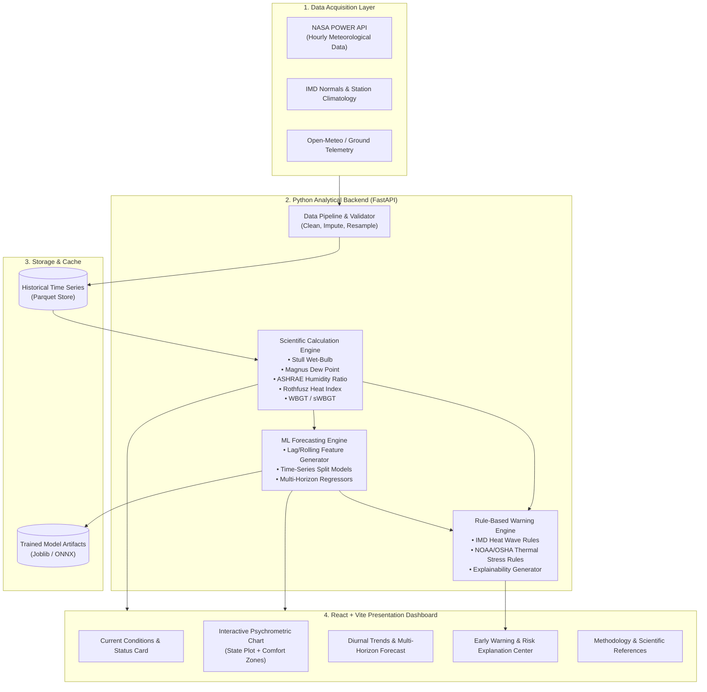

# Phase 1 — Research, Requirements & Scientific Foundation
**Project Title**: AI Based Dashboard Development for Microclimate Prediction and Advanced Warning System for Thermal Comfort / Heat Waves  
**Supervisor**: Prof. Chirodeep Bakli  
**Team**: Two Undergraduate Students (BTP)  
**Milestone**: Phase 1 Foundation Document  

---

## 1. Executive Summary & Problem Statement

### 1.1 Problem Statement
Urbanization, altered land cover, and climate change are intensifying localized microclimates and exacerbating severe heat waves across vulnerable regions, particularly in India. Traditional macroclimate weather forecasts provide synoptic regional forecasts at spatial scales of 12–50 km, often failing to capture localized human thermal stress, urban heat island (UHI) phenomena, and rapid microclimate variations experienced at ground level (2 m height). 

Furthermore, extreme thermal distress is not a simple function of ambient dry-bulb temperature ($T_{db}$) alone; humidity, radiation, and air movement dictate human thermoregulation (evaporative cooling through sweating). High humidity alongside elevated temperatures can cause dangerous physiological strain even when dry-bulb temperatures appear moderate.

Existing tools often either present raw sensor telemetry without physiological risk interpretation or provide static thermal comfort calculations without predictive forecasting and actionable early-warning alerts.

### 1.2 Proposed Solution
An integrated, research-oriented, web-based analytical platform and early warning system that:
1. Ingests, cleans, and standardizes multi-source meteorological and microclimate observations (NASA POWER, IMD guidelines, open reanalysis/station datasets).
2. Executes a rigorous, validated **Scientific Calculation Engine** (psychrometric parameters, wet-bulb temperature, Heat Index, WBGT, and thermal indices).
3. Visualizes real-time and historical psychrometric dynamics on an interactive, mathematically accurate **Psychrometric Chart** with designated human comfort boundaries.
4. Leverages **Explainable Machine Learning (AI/ML)** to predict short-term (1 to 24 hours ahead) microclimate parameters and thermal stress trajectories.
5. Generates **Rule- and Model-driven Early Warnings** grounded in official IMD heat-wave criteria and international occupational heat-stress thresholds (NOAA/NWS, OSHA, ISO 7243).
6. Delivers a clean, modular, and defensible dashboard suitable for academic demonstration, student defense, and operational utility.

### 1.3 Target Users
1. **Academic Evaluators & Researchers**: Analyzing microclimate dynamics, psychrometric behaviors, and ML forecast reliability.
2. **Municipal / Campus Facility Managers**: Managing local outdoor activities, scheduling heavy labor, or triggering heat mitigation (misting, shading, hydration alerts).
3. **General Public / Vulnerable Populations**: Outdoor workers, students, and athletes needing clear, real-time advice on thermal stress levels.

---

## 2. Scientific & Thermodynamic Foundations

### 2.1 Microclimate vs. Macroclimate
- **Macroclimate**: Regional or synoptic-scale atmospheric conditions governed by general circulation patterns (mesoscale $\sim 10-100\text{ km}$).
- **Microclimate**: The localized suite of climatic variables measured near the ground ($0-2\text{ m}$) within a specific micro-environment (canopy, street canyon, park, open ground), modified by local topography, surface albedo, vegetative cover, soil moisture, and anthropogenic heat emissions.

### 2.2 Thermal Comfort vs. Heat Stress vs. Heat Wave
- **Thermal Comfort**: Defined by ASHRAE Standard 55 as "that condition of mind that expresses satisfaction with the thermal environment and is assessed by subjective evaluation." It occurs when internal heat production matches environmental heat dissipation with minimal physiological strain.
- **Heat Stress**: The net heat load imposed on the human body through metabolic heat generation and environmental factors (radiation, air temperature, air velocity, humidity). When heat dissipation mechanisms (primarily sweat evaporation) are hindered, core temperature rises, leading to heat cramps, exhaustion, and potentially lethal heat stroke.
- **Heat Wave**: An extended period of abnormally high temperatures relative to the historical climatological baseline of a specific geographical region.

### 2.3 Dry-Bulb, Wet-Bulb, and Dew-Point Temperatures
- **Dry-Bulb Temperature ($T_{db}$)**: The ambient air temperature measured by a clean, shielded thermometer unaffected by moisture or direct solar radiation.
- **Wet-Bulb Temperature ($T_{wb}$)**: The lowest temperature attainable through the adiabatic evaporative cooling of a water-wetted surface exposed to moving air. Measured physically with a wet-wick thermometer (psychrometer) or computed from psychrometric relations. It represents the thermodynamic limit of human cooling via perspiration. A sustained ambient $T_{wb} \ge 35^\circ\text{C}$ is widely recognized in human physiology as the absolute theoretical upper limit of human survivability, with acute danger occurring above $30-31^\circ\text{C}$.
- **Dew-Point Temperature ($T_{dp}$)**: The temperature to which air must be cooled at constant pressure and moisture content to become saturated with water vapor.

### 2.4 Psychrometric Chart Foundations
The psychrometric chart graphically depicts the thermodynamic properties of moist air at a specified atmospheric pressure ($P_{atm}$, typically $101.325\text{ kPa}$ at sea level):
1. **Abscissa (X-axis)**: Dry-bulb temperature $T_{db}$ ($^\circ\text{C}$).
2. **Ordinate (Y-axis)**: Humidity ratio $W$ or $r$ (mass of water vapor per unit mass of dry air, $\text{kg}_{w}/\text{kg}_{da}$ or $\text{g}_{w}/\text{kg}_{da}$).
3. **Saturation Curve ($100\%\text{ RH}$)**: The boundary curve representing saturated air where $T_{db} = T_{wb} = T_{dp}$.
4. **Relative Humidity ($RH\%$) Lines**: Curved contours representing ratios of actual vapor pressure to saturation vapor pressure.
5. **Wet-Bulb & Enthalpy Lines**: Diagonally sloping lines indicating states of constant adiabatic saturation and specific enthalpy $h$ ($\text{kJ/kg}$).
6. **Comfort Envelope**: Typically defined by ASHRAE 55 (e.g., Summer/Winter comfort polygons based on PMV/PPD or standard effective temperatures).

---

## 3. Review of Existing Systems & Literature

### 3.1 Benchmark Analysis: Australian University Microclimate Initiatives
Our web and literature investigation identified three benchmark initiatives from Australian institutions:

1. **SIMPaCT (Smart Irrigation Management for Parks and Cool Towns) — UTS (University of Technology Sydney) & SOPA**:
   - *Scope*: Digital twin and environmental microclimate monitoring deployed across Bicentennial Park (Sydney Olympic Park).
   - *Sensors/Data*: 202 soil-moisture probes, 50 Temperature-Relative Humidity (TRH) micro-nodes, and 13 automatic weather stations.
   - *Core Strength*: Integrates micro-sensor mesh with machine learning to forecast localized cooling effects from evapotranspiration.
   - *Takeaway for our BTP*: Demonstrates how localized microclimate telemetry can drive real-time predictive dashboards. However, SIMPaCT is heavily focused on irrigation control rather than human physiological heat warnings.

2. **University of Sydney (Heat and Health Research Centre & Thermal Ergonomics Lab)**:
   - *Key Tools*: "Sports Heat Tool" (endorsed by Sports Medicine Australia) and the **ASU/USYD HEAT-Lim** human heat strain threshold model.
   - *Core Strength*: Translates complex biometeorological parameters into clear, activity-specific safety thresholds (stop-play, enforced hydration breaks).
   - *Takeaway for our BTP*: High scientific credibility in heat warnings. Warnings must not be generic "Hot" flags; they must correlate with human heat strain thresholds.

3. **CBE Thermal Comfort Tool (UC Berkeley / Global Research Reference)**:
   - *Platform*: Globally utilized interactive web tool implementing ASHRAE 55, ISO 7730, and EN 16798.
   - *Core Strength*: Interactive psychrometric charts, PMV/PPD calculators, and Standard Effective Temperature (SET) calculations.
   - *Takeaway for our BTP*: Clear visual conventions for plotting psychrometric points and comfort envelopes without clutter.

### 3.2 What Our Project Must Adopt vs. Avoid
- **Adopt**:
  - Exact, published thermodynamic relationships (ASHRAE, Goff-Gratch, Stull).
  - Multi-tier alert levels (Normal $\to$ Caution $\to$ Extreme Caution $\to$ Danger $\to$ Extreme Danger).
  - Clear separation between raw observations, computed indices, and ML forecasts.
- **Avoid**:
  - Relying on heavy proprietary GIS/digital-twin software that cannot be run locally by two students.
  - Blindly copying indoor thermal comfort equations (e.g., Fanger PMV without solar radiation adjustment) for outdoor heat-wave predictions.

---

## 4. Scientific Metric Specifications & Candidate Datasets

### 4.1 Thermal Indices Evaluation

| Metric | Formula / Algorithm Source | Required Inputs | Range / Units | Strengths & Limitations | Selected for BTP? |
| :--- | :--- | :--- | :--- | :--- | :--- |
| **Wet-Bulb Temp ($T_{wb}$)** | Stull (2011) empirical equation & psychrometric iteration | $T_{db}$ ($^\circ\text{C}$), $RH$ ($\%$) | $^\circ\text{C}$ | Essential physiological metric; $T_{wb} > 30^\circ\text{C}$ indicates dangerous heat stress. | **YES (Primary)** |
| **Dew Point ($T_{dp}$)** | Magnus-Tetens approximation (Sonntag 1990) | $T_{db}$, $RH$ | $^\circ\text{C}$ | High accuracy ($\pm 0.1^\circ\text{C}$) for environmental ranges; needed for psychrometrics. | **YES (Primary)** |
| **Humidity Ratio ($W$)** | ASHRAE Fundamentals (Dalton's Law) | $T_{dp}$, $P_{atm}$ | $\text{kg}_w/\text{kg}_{da}$ | Core coordinate for psychrometric chart plotting. | **YES (Primary)** |
| **Heat Index (HI)** | Rothfusz regression (NOAA/NWS 1990) | $T_{db}$ ($^\circ\text{F}$ or $^\circ\text{C}$), $RH$ ($\%$) | $^\circ\text{C}$ | Industry standard for shaded, low-wind conditions; valid for $T \ge 27^\circ\text{C}, RH \ge 40\%$. | **YES (Primary)** |
| **Simplified WBGT (sWBGT)** | Australian BoM formula: $0.567 T_{db} + 0.393 e + 3.94$ | $T_{db}$ ($^\circ\text{C}$), Vapor pressure $e$ ($\text{hPa}$) | $^\circ\text{C}$ | Approximates outdoor WBGT under moderate sun and light wind without black globe hardware. | **YES (Primary)** |
| **Full WBGT (Liljegren et al.)** | Liljegren et al. (2008) radiative heat balance | $T_{db}, RH, WS, \text{Solar Radiation}, \text{Zenith}$ | $^\circ\text{C}$ | Gold standard for sports/occupational safety; requires solar radiation ($W/m^2$). | **YES (Phase 3 Extension)** |
| **UTCI** | 6th-order polynomial fit to Fiala multi-node human model | $T_{db}, RH, WS, T_{mrt}$ | $^\circ\text{C}$ | Comprehensive physiological biometeorological model; complex calculation of Mean Radiant Temp ($T_{mrt}$). | **Candidate (Secondary)** |

### 4.2 Official Early Warning Thresholds
1. **India Meteorological Department (IMD) Heat-Wave Criteria**:
   - Minimum threshold: Maximum $T_{db} \ge 40^\circ\text{C}$ (plains) or $\ge 30^\circ\text{C}$ (hilly areas).
   - *Based on Departure*:
     - **Heat Wave**: Departure from normal of $4.5^\circ\text{C}$ to $6.4^\circ\text{C}$.
     - **Severe Heat Wave**: Departure from normal $> 6.4^\circ\text{C}$.
   - *Based on Absolute Temperature*:
     - **Heat Wave**: $T_{max} \ge 45^\circ\text{C}$.
     - **Severe Heat Wave**: $T_{max} \ge 47^\circ\text{C}$.
2. **NOAA / NWS Heat Index Alert Levels**:
   - **Caution**: $27^\circ\text{C} - 32^\circ\text{C}$ ($80^\circ\text{F} - 90^\circ\text{F}$) — Fatigue possible with prolonged exposure.
   - **Extreme Caution**: $32^\circ\text{C} - 39^\circ\text{C}$ ($90^\circ\text{F} - 103^\circ\text{F}$) — Heat stroke, heat cramps, or heat exhaustion possible.
   - **Danger**: $39^\circ\text{C} - 51^\circ\text{C}$ ($103^\circ\text{F} - 124^\circ\text{F}$) — Heat cramps or heat exhaustion likely; heat stroke possible.
   - **Extreme Danger**: $\ge 51^\circ\text{C}$ ($\ge 125^\circ\text{F}$) — Heat stroke highly imminent.
3. **OSHA / ISO 7243 WBGT Action Thresholds**:
   - **Low Risk**: WBGT $< 26.7^\circ\text{C}$ ($80^\circ\text{F}$).
   - **Moderate Risk**: WBGT $26.7^\circ\text{C} - 29.4^\circ\text{C}$ ($80-85^\circ\text{F}$).
   - **High Risk**: WBGT $29.4^\circ\text{C} - 32.2^\circ\text{C}$ ($85-90^\circ\text{F}$).
   - **Extreme Risk**: WBGT $> 32.2^\circ\text{C}$ ($>90^\circ\text{F}$) — Suspend non-essential heavy outdoor labor.

### 4.3 Data Sources Evaluation

| Source | Parameters Available | Spatial/Temporal Resolution | Access Method & License | Suitability for BTP |
| :--- | :--- | :--- | :--- | :--- |
| **NASA POWER API** | $T_{2m}, RH_{2m}, WS_{2m}, P_{sfc}, \text{Solar Radiation}$ | Global $0.5^\circ \times 0.5^\circ$, Hourly from 2001 to near-present | Free REST API, JSON/CSV, no auth key required | **EXCELLENT (Primary pipeline)** |
| **IMD Observational Data** | $T_{max}, T_{min}, RH$, Rainfall, Climatological Normals | Station-based, Daily (some automatic weather stations hourly) | Open Government Data (OGD) India / IMD Pune archives | **HIGH (Validation & Normal departure baselines)** |
| **Open-Meteo Historical & Forecast API** | Temperature, Humidity, Dew Point, Radiation, Wind, Weather Code | High resolution ($1-5\text{ km}$ downscaled), Hourly historical + 7-day forecast | Free non-commercial API, no key required | **EXCELLENT (Real-time & validation testing)** |
| **ERA5-Land (ECMWF)** | Reanalysis: all physical atmospheric surface parameters | $0.1^\circ \times 0.1^\circ$ ($\sim 9\text{ km}$), Hourly from 1950 | CDS API (requires registration, batch download) | **GOOD (Benchmark comparison)** |

---

## 5. Candidate Prediction Targets & ML Architecture

### 5.1 Formulation of the Machine Learning Problem
A critical research pitfall in BTPs is attempting to predict a complex derived index (like Heat Index or WBGT) directly using a black-box model without physical guarantees.
Our architecture defines two scientifically grounded formulation options:

- **Target Option A (Physical Parameter Forecast $\to$ Thermodynamic Calculation Engine)**:
  - Predict future physical variables: $\hat{T}_{db}(t+\Delta t)$ and $\widehat{RH}(t+\Delta t)$ for horizons $\Delta t \in \{1, 3, 6, 24\text{ hours}\}$.
  - Compute $\widehat{\text{HI}}$ and $\widehat{T}_{wb}$ through the validated thermodynamic equations.
  - *Advantage*: Guarantees physical consistency; psychrometric plotting is strictly valid because the predicted state coordinates $(T_{db}, W)$ remain thermodynamically sound.
- **Target Option B (Direct Multi-Horizon Heat Stress Index / Risk Class Forecast)**:
  - Predict $\widehat{\text{WBGT}}(t+\Delta t)$ directly or classify risk category (Normal vs Caution vs Danger).
  - *Advantage*: Direct optimization of warning recall and minimization of false negatives in safety classification.

*Recommendation for BTP*: Implement Option A as the primary forecasting engine (as it naturally populates the future state on the Psychrometric chart) and augment with Option B for risk category classification and evaluation.

### 5.2 Feature Engineering Strategy
- **Temporal/Cyclic Features**: Hour of day ($\sin(2\pi h/24), \cos(2\pi h/24)$), Day of year ($\sin(2\pi d/365), \cos(2\pi d/365)$).
- **Lagged Observations**: $T(t-1), T(t-2), T(t-3), T(t-24)$, $\Delta T_{1h} = T(t) - T(t-1)$, $\Delta T_{24h} = T(t) - T(t-24)$.
- **Rolling Statistics**: Rolling mean, rolling min, rolling max over 3-hour, 6-hour, and 24-hour windows.
- **Diurnal Heat Accumulation**: Cumulative degree-hours above baseline ($T > 35^\circ\text{C}$).
- **Validation**: Strict chronologically ordered train/validation/test split (e.g., 2020–2022 train, 2023 validation, 2024 test) to eliminate look-ahead bias and data leakage.

---

## 6. Functional & Non-Functional Requirements

### 6.1 Functional Requirements (FR)
- **FR-1 (Ingestion)**: Ingest hourly meteorological time series for designated Indian coordinates (e.g., New Delhi, Kharagpur/Kolkata, Ahmedabad).
- **FR-2 (Thermodynamics)**: Accurately compute $T_{wb}, T_{dp}, W, e, h, \text{Heat Index}$, and $\text{sWBGT}$ for each observation.
- **FR-3 (Psychrometric Plotting)**: Render an interactive psychrometric chart displaying the saturation line, $RH$ curves, wet-bulb diagonals, comfort polygon, and plotted operational trajectory.
- **FR-4 (ML Inference)**: Run multi-horizon forecasts ($t+1\text{h}$ to $t+24\text{h}$) using trained regression models.
- **FR-5 (Explainable Warnings)**: Generate explicit warning banners detailing the exact threshold trigger (e.g., "Heat Index $= 42.4^\circ\text{C}$ exceeds Danger threshold ($39^\circ\text{C}$)").
- **FR-6 (Auditability & Traceability)**: Display data provenance, formula citations, model version, and last-updated timestamps.

### 6.2 Non-Functional Requirements (NFR)
- **NFR-1 (Reproducibility)**: Zero hard-coded magic constants; all thresholds isolated in configuration files (`config.yaml`).
- **NFR-2 (Modularity)**: Scientific calculation routines completely decoupled from UI code, with standalone unit tests.
- **NFR-3 (Performance)**: API responses $< 250\text{ ms}$ for real-time inference and chart data generation.
- **NFR-4 (Academic Explainability)**: Codebase written in clear Python and standard frontend components without obfuscated abstractions.

---

## 7. Recommended Technology Stack & Rationale

| Layer | Recommended Choice | Rationale & Trade-off Analysis |
| :--- | :--- | :--- |
| **Backend & API** | **Python 3.10+ with FastAPI** | FastAPI provides automatic OpenAPI documentation, asynchronous performance, and native typing. Bridges seamlessly with Python's data science ecosystem (`NumPy`, `pandas`, `scikit-learn`). |
| **Data Engine & ML** | **pandas, NumPy, SciPy, scikit-learn, XGBoost** | Industry and academic standard for tabular and time-series feature engineering; completely defensible in undergraduate thesis viva. |
| **Storage & Cache** | **SQLite + Parquet** | SQLite for station metadata and user configurations; compressed Parquet files for high-speed time-series retrieval without requiring the complexity of managing a dedicated PostgreSQL service. |
| **Frontend Framework** | **React + Vite + Modern Vanilla CSS** | Lightning-fast HMR, component modularity, standard web standards, rich interactive styling without Tailwind lock-in. |
| **Visualization** | **Plotly.js / SVG + Canvas** | Plotly provides publication-grade scientific plotting (ideal for non-linear psychrometric grids and diurnal heat trajectories) with built-in pan/zoom and hover tooltips. |

---

## 8. System Architecture Overview

---

## 9. Risks, Limitations & Open Questions

### 9.1 Risks & Mitigations
1. **Radiation Data Availability**: Full outdoor WBGT and UTCI require solar irradiance ($W/m^2$) and mean radiant temperature ($T_{mrt}$), which are absent from basic temperature/humidity sensors.
   - *Mitigation*: We implement both Simplified WBGT ($\text{sWBGT}$) that functions with ambient $T$ and vapor pressure, and full WBGT for datasets containing NASA solar radiation.
2. **Microclimate Sensor Scale vs. Gridded Data**: NASA POWER represents a $0.5^\circ$ spatial grid, which smooths out micro-scale street canyon effects.
   - *Mitigation*: Document this limitation clearly in the thesis. The dashboard will be architected to ingest point-source weather station data (e.g., campus station) alongside satellite/reanalysis data.
3. **Temporal Leakage in Machine Learning**: Standard k-fold cross validation artificially inflates model accuracy on time-series data.
   - *Mitigation*: Strictly enforce rolling-origin or block time-series cross-validation.

### 9.2 Open Questions for Project Trajectory
1. What specific geographic coordinates / pilot cities should serve as our primary benchmark locations? (e.g., New Delhi for extreme dry heat waves, Kolkata/coastal for extreme humid heat stress).
2. Would the supervisor prefer the ML model focus on single-step ahead ($t+1\text{h}$) forecasting or direct multi-horizon forecasts ($t+1\text{h}, t+3\text{h}, t+6\text{h}, t+24\text{h}$)?
