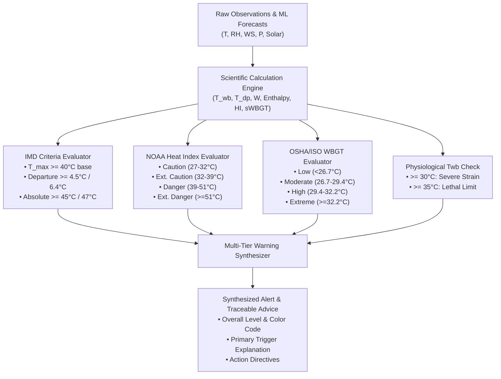

# Phase 7 — Forecasting & Advanced Warning System Report
**Project**: AI Based Dashboard Development for Microclimate Prediction and Advanced Warning System for Thermal Comfort / Heat Waves  
**Supervisor**: Prof. Chirodeep Bakli  
**Milestone**: Phase 7 Technical Documentation  

---

## 1. Scope & Objective
In Phase 7, we built the core operational early-warning engine ([`src/warning_engine.py`](file:///c:/Users/lovis/Desktop/BTP/src/warning_engine.py)).
The warning engine synthesizes:
1. **Real-time environmental observations** ($T_{db}, RH, WS, P_{sfc}, \text{Solar}$).
2. **Thermodynamic calculations** ($T_{dp}, T_{wb}, W, h, HI, \text{sWBGT}$).
3. **AI Champion multi-horizon forecasting** ($t+1\text{h}, t+3\text{h}, t+6\text{h}, t+24\text{h}$).
4. **Official multi-tier meteorological standards**:
   - India Meteorological Department (IMD) Heat Wave & Severe Heat Wave criteria (both climatological departure and absolute temperature thresholds).
   - NOAA/NWS Heat Index Alert Levels (Normal, Caution, Extreme Caution, Danger, Extreme Danger).
   - OSHA / ISO 7243 WBGT Occupational Risk Tiers (Low, Moderate, High, Extreme Risk).
   - Physiological critical wet-bulb limits ($T_{wb} \ge 30^\circ\text{C}$ and $T_{wb} \ge 35^\circ\text{C}$).
5. **Explainability & Traceability Engine**: Generates transparent, human-readable rationale detailing which parameters exceeded thresholds and presents prioritized action recommendations for municipal authorities, outdoor workers, and the general public.

---

## 2. Integrated Warning Methodology

---

## 3. Warning Levels & Trigger Logic

The engine resolves disparate thresholds into a single coherent risk level using a strict safety-first priority hierarchy:

| Level | Severity Name | Color Code | Dominant Triggers | Action Recommendations |
| :--- | :--- | :--- | :--- | :--- |
| **Tier 5** | **CRITICAL EMERGENCY** | `#512e5f` (Deep Violet) | $T_{wb} \ge 35^\circ\text{C}$ (Lethal Limit) or $T_{wb} \ge 30^\circ\text{C}$ (Severe Physiological Strain) | Immediate indoor shelter with air conditioning; halt all physical exertion and outdoor labor; deploy active cooling. |
| **Tier 4** | **EXTREME DANGER** | `#900c3f` (Dark Maroon) | IMD Severe Heat Wave ($T_{max} \ge 47^\circ\text{C}$ or Departure $> +6.4^\circ\text{C}$); NOAA Heat Index $\ge 51^\circ\text{C}$ | Heat stroke imminent with continued outdoor exposure; municipal shutdown of construction/sports (11:00–16:00); open public cooling shelters. |
| **Tier 3** | **DANGER** | `#e74c3c` (Bright Red) | IMD Heat Wave ($T_{max} \ge 45^\circ\text{C}$ or Departure $\ge +4.5^\circ\text{C}$); NOAA HI in Danger ($39-51^\circ\text{C}$); WBGT Extreme ($\ge 32.2^\circ\text{C}$) | High heat exhaustion probability; mandatory 15-minute rest breaks per hour for outdoor labor; stay hydrated and seek shade. |
| **Tier 2** | **EXTREME CAUTION** | `#e67e22` (Orange) | NOAA Heat Index $32-39^\circ\text{C}$; WBGT High ($29.4-32.2^\circ\text{C}$) | Fatigue possible with prolonged physical activity; enforce hydration breaks. |
| **Tier 1** | **CAUTION** | `#f1c40f` (Yellow) | NOAA Heat Index $27-32^\circ\text{C}$; WBGT Moderate ($26.7-29.4^\circ\text{C}$) | Normal activity acceptable with regular fluid intake. |
| **Tier 0** | **NORMAL** | `#2ecc71` (Green) | Conditions within baseline thermal comfort envelope | No thermal restrictions. |

---

## 4. Multi-Horizon Forecasting Integration

When queried with recent historical telemetry ($\ge 26\text{ hours}$), the engine:
1. Computes the **Current Warning Status** ($t$).
2. Executes inference with the location-specific Champion AI models across horizons $h \in \{1, 3, 6, 24\text{ hours}\}$:
   $$\hat{T}_{db}(t+h), \quad \widehat{RH}(t+h)$$
3. Propagates predicted states through the scientific engine to obtain predicted $HI(t+h), T_{wb}(t+h), \text{sWBGT}(t+h)$.
4. Produces anticipated warning levels with timestamps and expected triggers for each future horizon.

---

## 5. Verification & Unit Test Results

The suite in [`tests/test_warning_engine.py`](file:///c:/Users/lovis/Desktop/BTP/tests/test_warning_engine.py) tests:
- **IMD Rules**: Safdarjung normal baseline departure logic ($+4.6^\circ\text{C} \to \text{Heat Wave}$; $47.5^\circ\text{C} \to \text{Severe Heat Wave}$).
- **Multi-Tier Synthesis**: Benign inputs ($25^\circ\text{C}, 45\%$) evaluate to `NORMAL`, while severe heat inputs ($41^\circ\text{C}, 35\%$) trigger `DANGER` with explicit rationale strings.
- **Multi-Horizon Pipeline**: Real historical slices from the May 2024 heat wave produce complete 1h, 3h, 6h, and 24h predictions and warning classifications without missing fields.
- **Status**: All 3 test cases passed in $0.119\text{s}$.
